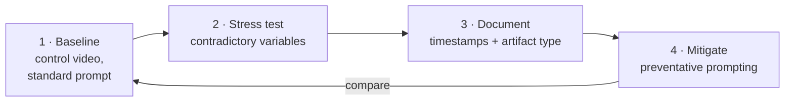

# 🎬 Adversarial Evaluation of Generative Video Models

### Black-box robustness testing of Google Veo 3: hallucination patterns, failure modes and cost-efficient prompting

[Key findings](#-key-findings) · [Methodology](#-methodology) · [Evidence](#-evidence) · [Roadmap](#-roadmap)

---

## 🔭 Overview

This repository documents black-box adversarial testing and prompt-engineering strategies for **Google Veo 3**. The work looks at three questions:

1. **Robustness:** where and how does the model break under contradictory or highly technical instructions?
2. **Hallucination:** which artifacts appear in high-fidelity "studio" generations?
3. **Cost:** how can an independent researcher with a limited credit budget get more usable output per generation?

**Researcher:** Abdishakur Mahdi Abdirahman · Jijiga, Ethiopia

## 📊 Key findings

### 1. Studio-lighting prompts fail about 80% of the time

| | |
|---|---|
| **Observation** | Prompts asking for specific studio lighting setups ("cinematic rim lighting", "softbox key light") failed in roughly **80%** of runs. |
| **Failure mode** | Stacked lighting descriptors produce hallucinated artifacts or incorrect lighting textures. |
| **Implication** | Veo 3 handles general descriptive prompts far better than precise cinematography commands. |

### 2. A preventative prompting framework cuts waste by 30–40%

| | |
|---|---|
| **Method** | Specific negative constraints plus optimized token ordering push the model to prioritize **geometry over stylistic texture** in the first render pass. |
| **Result** | About **30–40% fewer unusable generations**, saving credits during experimentation. |

## 🧪 Methodology

| Step | Detail |
|---|---|
| **Baseline generation** | Establish a control clip with a standard prompt |
| **Stress testing** | Combine contradictory variables (for example *fast motion* + *low shutter speed* + *high detail*) to force model collapse |
| **Documentation** | Log failure timestamps and artifact types: blurring, warping, temporal flicker, geometry collapse |

**Tooling:** Google Veo 3 · cloud inference (Google Labs) · manual frame-by-frame texture-consistency analysis.

## 🖼 Evidence

*Figure 1. Adversarial "studio lighting" test. The environment, including visible softboxes and a smoke setup, renders correctly at first. When camera movement introduces new temporal data, the scene suffers geometry collapse (a shattering effect).*

## 🗺 Roadmap

- [ ] **Automated eval script:** Python tooling to detect frame drops and consistency errors in generated video
- [ ] **Texture consistency score:** a metric for how well textures hold up during fast camera moves
- [ ] **Cross-model comparison:** benchmark Veo 3 against other state-of-the-art video models

## 📬 Contact

**Abdishakur Mahdi Abdirahman**, Systems Engineer and Independent AI Researcher
[GitHub @shacrawi92](https://github.com/shacrawi92) · [info@shacrawi.com](mailto:info@shacrawi.com)

## 📄 License

[GNU GPL v3](LICENSE)
